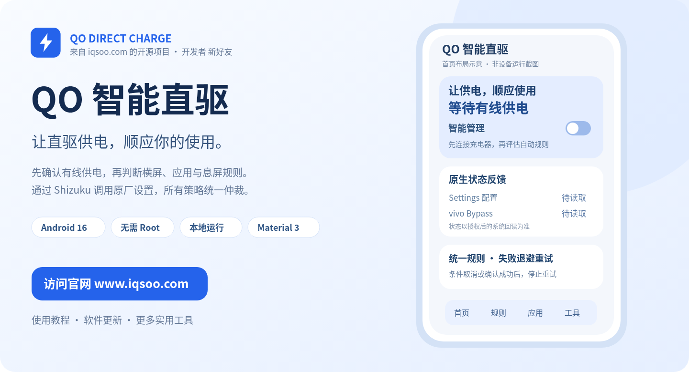
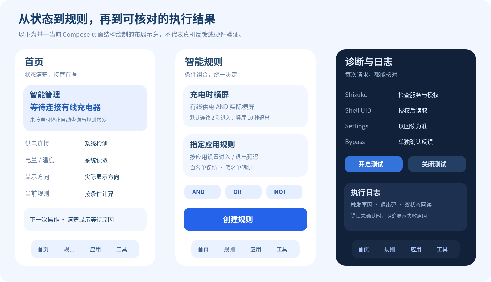

<p align="center">
  <a href="https://www.iqsoo.com">
    
  </a>
</p>

<h1 align="center">QO 智能直驱</h1>
<p align="center"><b>本项目由 <a href="https://www.iqsoo.com">iQSOO（iqsoo.com）</a> 发起并开源发布，开发者：新好友。</b></p>
<p align="center"><b>QO Direct Charge · 1.0.1</b></p>
<p align="center">Android 16 / OriginOS · Kotlin · Jetpack Compose · Shizuku · 无需 Root</p>
<p align="center">
  <a href="https://www.iqsoo.com"><b>访问官网 www.iqsoo.com</b></a> ·
  <a href="https://www.iqsoo.com/91.html">Shizuku 启动教程</a> ·
  <a href="#下载与安装">下载 APK</a> ·
  <a href="LICENSE">MIT 开源协议</a>
</p>

把已验证的原厂直驱设置入口，交给一个统一的规则引擎管理。先确认连接了有线充电器，再判断实际横屏、指定应用、息屏延迟、电量和温度。开启请求未确认时自动退避重试，条件不再满足就停止。

> **新好友的更多实用教程和工具，都在 [iQSOO · www.iqsoo.com](https://www.iqsoo.com)。**
> 第一次使用 Shizuku，可以先看站内的 [不用电脑启动 Shizuku 教程](https://www.iqsoo.com/91.html)，完成配对和启动后再回来授权本应用。

## 界面导览



Material 3、动态颜色、深色模式和完整简体中文。首页把 Settings 配置与 vivo Bypass 反馈分开显示；规则页负责条件组合，诊断和日志负责解释每次请求的结果。

上图依据当前 Compose 页面结构绘制，用于介绍布局。没有用示意图冒充真机截图，也没有用示意数值证明硬件已经进入旁路模式。

## 可以做什么

| 功能 | 实际行为 |
|---|---|
| 充电器优先 | 以 Android 官方外部供电信息判断接电。未接已验证的有线电源时，不执行自动规则、开启重试和直驱状态轮询。 |
| 横屏触发 | 根据实际显示方向，默认持续横屏 2 秒请求开启，持续竖屏 10 秒退出。 |
| 指定应用 | 应用选择、独立进入/退出延迟、横屏限制、白名单切换保持及黑名单；仅使用应用检测时要求使用情况访问。 |
| 失败自动重试 | 横屏开启未确认后等待 5、10、20 秒，之后每隔 30 秒继续。每次重新检查当前规则、供电和保护条件。 |
| 息屏管理 | 默认息屏 60 秒后退出，可选其他延迟、自定义或保持原状态；亮屏取消未到期任务。 |
| 自定义规则 | AND / OR / NOT、优先级、延迟、生效时段、复制、编辑和导入导出，由统一引擎决定最终动作。 |
| 原生手动优先 | 暂停、手动控制或检测到后续原生开关变化时停止争抢；无规则命中时尽可能恢复接管前状态。 |
| 可核对的诊断 | 检查 Shizuku、shell UID、Settings、Bypass、退出码与错误原因，支持开启/关闭测试和日志导出。 |

## 先确认适用条件

- **目标设备：iQOO Neo11（V2520A），Android 16 / OriginOS。** 不承诺其他机型、系统版本或所有 vivo 设备通用。
- Shizuku 通过无线调试启动，授予本应用权限；UserService 应为 shell UID **2000**，无需 Root。
- 仅允许已验证类型的 USB / AC 有线外部供电。无线和底座供电保持禁止自动触发。
- 默认电量范围 20%～100%，温度达到 42°C 暂停，降至 39°C 后再评估；这些是软件策略，可在界面修改。
- App 本身没有联网权限。官网入口由系统浏览器打开，规则、设置与日志保存在本机。

**Settings=1、Bypass=1 表示配置和厂商反馈已同步，不能单凭这两个值证明电源芯片的实际工作模式。** 本应用不改写厂商 persist 属性、温控阈值、电流、电压或原厂电池保护。

## 第一次使用

1. 从本页底部下载并安装 APK。升级前先暂停旧版智能管理，再覆盖安装。
2. 按 [站内 Shizuku 启动教程](https://www.iqsoo.com/91.html) 完成无线调试配对和启动。**配对完成与服务已经启动是两件事**，应在 Shizuku 中确认服务正在运行。
3. 打开 QO 智能直驱，点击“申请 / 检查 Shizuku 授权”，允许本应用；到“工具 → 诊断与验证”检查连接与 UID。
4. 接上有线充电器，保持电量、温度符合策略要求。需要诊断测试时分别观察 Settings 和 Bypass，不把超时当成功。
5. 回到首页，**开启“智能管理”总开关**并授予通知权限。只授权 Shizuku，不会自动打开智能管理。
6. 先不添加应用规则，在运行设置启用横屏触发，关闭“横屏仅限所选应用”，让应用真正全屏横向显示并保持数秒。
7. 如已点击过手动开启/关闭测试，先点“结束手动优先，恢复自动管理”。以后再按需要添加应用规则和息屏延迟。

退出自动管理的含义是恢复软件接管前状态。若原生直驱原本由你开启，退出规则后也可能继续保持开启。

## 遇到问题先看哪里

| 现象 | 检查与处理 |
|---|---|
| 横拿手机没有触发 | 首页是否显示实际横屏；应用锁竖屏、旋转锁定或只旋转手机姿态都不等于显示横屏。 |
| 授权后仍不自动开启 | 首页智能管理是否已打开、服务是否运行、是否暂停或处于手动优先。 |
| 显示等待有线供电 | 检查 USB/AC 外部供电信息；不以“电池正在充电”这一状态单独判断是否接电。 |
| 指定应用没有命中 | 检查使用情况访问和前台识别；未知或多窗口状态不会靠猜测强行切换。 |
| Settings 开了、Bypass 没同步 | 视为未确认；符合横屏条件时按退避策略重试，在诊断和日志中查看实际错误。 |
| 等待重试时转竖屏、拔线或息屏 | 取消原开启重试；必要的退出动作继续遵循原有保护和延迟策略。 |
| 重启后不能控制 | 先重新启动 Shizuku，再检查授权和自动管理服务。重启后不会盲目回写旧状态。 |
| 息屏执行晚于设置时间 | Android Doze 和厂商后台策略可能延后调度，不承诺精确秒数或永久常驻。 |

更多背景和相关手机操作教程，请访问 **[www.iqsoo.com](https://www.iqsoo.com)**。

## 验证记录与工程

当前 1.0.1 已完成 API 36 编译、**94 项 JVM 单元测试**、Android Lint（0 错误，13 条可选依赖版本提示）、APK Debug 签名与 16 KB 对齐检查。Android 设备 UI 测试仅完成编译。

用户反馈 1.0.0 开启智能管理后，横屏自动触发成功；**1.0.1 新增重试、真实关闭反馈、OriginOS 后台行为和实际硬件模式仍需设备验证**。构建与单元测试通过不等于已经完成全部真机验收。

- [测试报告](TEST_REPORT.md) · [设备验收清单](DEVICE_CHECKLIST.md) · [更新记录](CHANGELOG.md)
- [构建说明](docs/BUILDING.md) · [架构与控制边界](docs/ARCHITECTURE.md)
- [参与贡献](CONTRIBUTING.md) · [安全反馈](SECURITY.md) · [第三方许可](THIRD_PARTY_NOTICES.md)

```text
app/src/main/java/com/iqsoo/qodirect/
  automation/     统一规则、供电门禁、状态机和退避重试
  charging/       控制器、双状态回读与接管恢复
  shizuku/        官方 API、AIDL UserService 和固定命令
  monitoring/     供电、实际方向、前台应用和息屏监听
  foreground/     specialUse 前台服务和可取消调度
  repository/     DataStore、规则与日志数据流
  database/       Room
  ui/             Compose 页面与 ViewModel
```

项目自有代码采用 [MIT License](LICENSE)。第三方组件保留各自许可。开发者：**新好友（iQSOO）**。

## 下载与安装

**当前版本：1.0.1（versionCode 2）**。安装包是合法 Debug 签名，沿用已交付版本的证书；没有伪造正式 Release 签名。

| 文件 / 入口 | 下载 |
|---|---|
| **Android APK，约 29.09 MiB** | **[下载 QO-Direct-Charge-debug.apk](https://github.com/iQSOO/qo-direct-charge/releases/download/v1.0.1/QO-Direct-Charge-debug.apk)** |
| 中国移动云盘 · 1.0.1 | **[备用下载：移动云盘](https://yun.139.com/shareweb/#/w/i/2yA8vdzxXuha4)** |
| 完整公开源码包 | [QO-Direct-Charge-source.zip](https://github.com/iQSOO/qo-direct-charge/releases/download/v1.0.1/QO-Direct-Charge-source.zip) |
| SHA-256 校验文件 | [SHA256SUMS.txt](https://github.com/iQSOO/qo-direct-charge/releases/download/v1.0.1/SHA256SUMS.txt) |
| 全部版本 | [GitHub Releases](https://github.com/iQSOO/qo-direct-charge/releases) |

APK SHA-256：

```text
bcdfde0190b952d22826140af3a3ec9b4d5fd7e0a3e326518897b55328083f2d
```

<p align="center"><b>新好友 · iQSOO</b><br /><a href="https://www.iqsoo.com">www.iqsoo.com — 更多实用教程与原创工具</a></p>
