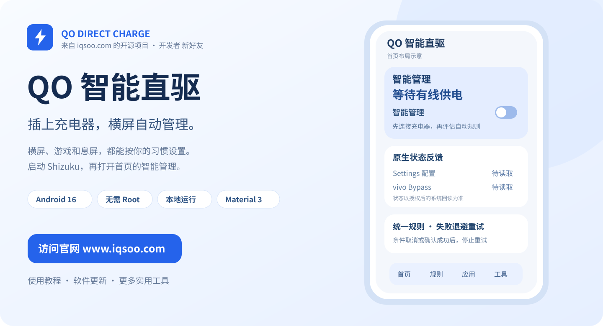
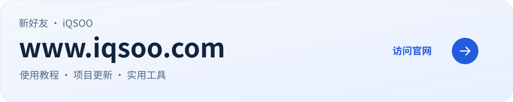

<p align="center">
  <a href="https://www.iqsoo.com">
    <picture>
      <source media="(prefers-color-scheme: dark) and (max-width: 600px)" srcset="docs/assets/hero-mobile-dark.svg" />
      <source media="(max-width: 600px)" srcset="docs/assets/hero-mobile.svg" />
      <source media="(prefers-color-scheme: dark)" srcset="docs/assets/hero-dark.svg" />
      
    </picture>
  </a>
</p>

<h1 align="center">QO 智能直驱</h1>
<p align="center"><strong>面向 iQOO Neo11 的原生直驱自动化工具</strong></p>
<p align="center">由<strong>新好友</strong>开发，<a href="https://www.iqsoo.com"><strong>iQSOO · iqsoo.com</strong></a> 发起并开源发布。</p>
<p align="center"><code>Android 16</code> &nbsp; <code>OriginOS</code> &nbsp; <code>Shizuku</code> &nbsp; <code>Kotlin / Compose</code> &nbsp; <code>MIT</code></p>
<p align="center">
  <a href="https://www.iqsoo.com"><strong>访问官网 ↗</strong></a> &nbsp; · &nbsp;
  <a href="https://b23.tv/TRkUNyx">观看演示</a> &nbsp; · &nbsp;
  <a href="https://www.iqsoo.com/7656.html">完整教程</a> &nbsp; · &nbsp;
  <a href="#下载与安装">下载 APK ↓</a>
</p>

---

**接上充电器，让直驱跟随你的使用场景。**

QO 智能直驱通过 Shizuku 调用 iQOO 原厂直驱设置，根据实际显示方向、前台应用、息屏时间及电池状态统一安排开启与退出。适合经常边接电边玩横屏游戏，希望减少重复操作的用户。

无需 Root，应用不申请联网权限。规则、设置和日志保存在手机本地，原厂温控与充电保护继续生效。源码和版本更新在本仓库维护，使用教程与更多工具发布于 **[www.iqsoo.com](https://www.iqsoo.com)**。

> **开始使用：** 启动 Shizuku → 授权本应用 → 接入有线充电器 → 打开首页「智能管理」。Shizuku 授权与智能管理总开关需要分别开启。

## 功能概览

<table>
  <tr>
    <td width="50%" valign="top">
      <h3>01 · 横屏自动接管</h3>
      <p>依据实际显示方向触发。支持横屏进入、竖屏退出延迟，也可限定为所选应用。</p>
    </td>
    <td width="50%" valign="top">
      <h3>02 · 应用独立规则</h3>
      <p>按应用配置进入与退出条件、延迟和黑名单；符合条件的应用之间切换时保持接管。</p>
    </td>
  </tr>
  <tr>
    <td valign="top">
      <h3>03 · 息屏与恢复</h3>
      <p>支持息屏延迟退出、自定义时间或保持原状态。提前亮屏时取消待执行任务，重新评估条件。</p>
    </td>
    <td valign="top">
      <h3>04 · 条件组合</h3>
      <p>组合电量、温度、时间段与应用条件，使用 AND、OR、NOT 和优先级管理多条规则。</p>
    </td>
  </tr>
  <tr>
    <td valign="top">
      <h3>05 · 失败重试</h3>
      <p>横屏自动开启未获确认时，按间隔回读状态并重试。成功、断电或条件失效后停止。</p>
    </td>
    <td valign="top">
      <h3>06 · 状态与诊断</h3>
      <p>分别展示原生配置、厂商反馈、当前规则和执行记录；支持手动测试与日志导出。</p>
    </td>
  </tr>
</table>

## 界面与演示


首页查看供电与规则状态，规则页调整使用条件，诊断页核对执行结果。界面采用 Jetpack Compose 与 Material 3，支持动态配色和深色模式。

**[观看视频：iQOO 手机自动开启与关闭直驱供电 ↗](https://b23.tv/TRkUNyx)**

## 使用条件

| 项目 | 当前范围 |
|---|---|
| 目标设备 | **iQOO Neo11（V2520A）** |
| 目标系统 | **Android 16 / OriginOS** |
| 控制权限 | Shizuku 已启动，并已授权 QO 智能直驱；无需 Root |
| 自动触发供电 | USB / AC 有线外部供电；无线与底座供电暂不开放 |
| 应用识别 | 使用指定应用规则时，需要使用情况访问权限 |
| 后台管理 | 用户主动开启智能管理，通过前台服务和常驻通知维护状态 |

其他机型与系统版本需要分别验证。Doze 和厂商后台策略可能延后息屏任务，后台执行时间以系统调度为准。

## 快速开始

1. **安装应用。** 从本页底部下载 APK。已有旧版时，先暂停智能管理，再覆盖安装。
2. **启动 Shizuku。** 完成配对后回到 Shizuku 启动服务。首次使用可参照 [iQSOO 无线调试启动教程](https://www.iqsoo.com/91.html)。
3. **完成授权。** 在 QO 智能直驱中点击「申请 / 检查 Shizuku 授权」，允许访问。无 Root 的控制服务应在诊断页显示 shell UID `2000`。
4. **开启智能管理。** 接上有线充电器，打开首页总开关并允许通知权限。
5. **验证横屏触发。** 启用横屏规则，首次测试关闭「横屏仅限所选应用」。进入真正横向显示的全屏应用，保持至少 2 秒，再查看配置与厂商反馈。
6. **设置日常规则。** 基础触发正常后，再选择游戏、设置退出延迟和保护条件。如果使用过手动测试，先选择「结束手动优先，恢复自动管理」。

手机重启后，请先确认 Shizuku 已重新运行。完整图文说明见 **[官网使用教程](https://www.iqsoo.com/7656.html)**。

## 自动管理如何工作

**先确认供电，再评估规则，最后执行并回读。** 所有控制请求统一排队，避免多条规则同时切换原生开关。

| 场景 | 默认处理 |
|---|---|
| 未连接已验证的有线电源 | 暂停自动规则、开启重试、原生状态轮询与前台应用查询 |
| 符合条件的应用横屏 | 持续 **2 秒**后请求开启 |
| 恢复竖屏 | 持续 **10 秒**后退出横屏规则 |
| 息屏 | **60 秒**后退出；可另设延迟或保持策略 |
| 横屏开启失败 | 从本次失败结束起，依次等待 **5 / 10 / 20 秒**，之后每次等待 **30 秒**重新评估 |
| 拔掉充电器 | 结束自动接管；存在接管记录时仅尝试一次恢复，不持续重试 |
| 暂停或结束智能管理 | 尽可能恢复本次接管前状态 |
| 检测到后续原生手动切换 | 保留手动优先，等待用户恢复自动管理 |

每次重试前都会重新检查供电、方向、权限、温度和当前规则，并回读原生状态。目标已经得到确认时不再重复写入。自动开启重试仅在条件持续成立时进行。

默认允许触发的电量范围为 **20%～100%**；温度达到 **42°C** 时暂停，降至 **39°C** 后重新评估。这些是可调整的软件策略，原厂电池保护始终保留。

### 正确理解状态反馈

| 显示项 | 含义 |
|---|---|
| `Settings = 1` | 原生直驱配置已设为开启 |
| `Bypass = 1` | vivo 厂商旁路反馈标志已置位 |
| 请求失败 / 超时 | 本次请求未完成预期确认，可在日志查看退出码、回读结果和原因 |

两项状态可能存在同步延迟。配置与厂商标志用于确认软件请求；电源芯片的实际工作模式仍需结合设备测量验证。

## 常见问题

<details>
<summary><strong>已经授权，为什么横屏后没有动作？</strong></summary>

先检查首页「智能管理」是否开启、有线电源是否被识别，以及当前是否处于暂停或手动优先。再确认应用实际横向显示；仅把手机拿横，应用仍保持竖屏，不会触发横屏规则。

使用指定应用规则时，还需要检查使用情况访问权限和应用选择。前台信息不明确时，软件会等待可靠状态。

</details>

<details>
<summary><strong>Settings 已开启，Bypass 仍未同步怎么办？</strong></summary>

在诊断页刷新，查看日志中的确认超时和反馈值。符合自动重试条件时，软件会按间隔重新检查；手动测试失败不会转为无限重试。持续不一致时，请保存日志并附设备型号、系统版本反馈。

</details>

<details>
<summary><strong>暂停管理后，为什么原生直驱仍然开启？</strong></summary>

结束接管会尽可能恢复接管前状态。如果接管前已经由你手动开启，恢复后也可能保持开启。需要明确关闭时，可在诊断页执行关闭测试并重新确认反馈。

</details>

<details>
<summary><strong>息屏或重启后，需要注意什么？</strong></summary>

息屏任务可能受 Doze 与 OriginOS 后台策略影响。提前亮屏会取消尚未到期的退出任务。手机重启后，先检查 Shizuku 运行状态，再确认智能管理和授权；软件会读取当前状态，不会盲目写入上次保存的充电状态。

</details>

## 工程与验证

项目使用 **Kotlin、Jetpack Compose、Material 3、官方 Shizuku API 与 UserService**。ViewModel 通过 StateFlow 驱动界面，DataStore 保存设置，Room 保存规则和日志；后台管理使用 `specialUse` 前台服务。

控制层只写入已验证的原厂 Settings 入口。厂商 `persist` 属性用于只读查询，不修改温控、电流或电压参数。

| 1.0.1 检查项 | 结果 |
|---|---|
| Android API 36 编译与 APK 打包 | 通过 |
| JVM 单元测试 | **94 项通过，0 失败** |
| Android Lint | 0 错误，13 条可选依赖版本提示 |
| APK 签名、ZIP 与 16 KB 对齐 | 通过 |
| 设备 UI 测试 | 通过 |
| 模拟器与 1.0.1 | 通过 |

已有用户反馈：1.0.0 打开智能管理后横屏触发成功。1.0.1 新增重试、原生关闭反馈与 OriginOS 后台表现，仍需按设备清单验证。

| 开发文档 | 项目协作 |
|---|---|
| [架构与控制流程](docs/ARCHITECTURE.md) | [参与贡献](CONTRIBUTING.md) |
| [构建与依赖版本](docs/BUILDING.md) | [问题反馈](https://github.com/iQSOO/qo-direct-charge/issues) |
| [测试报告](TEST_REPORT.md) · [设备验收清单](DEVICE_CHECKLIST.md) | [安全反馈](SECURITY.md) |
| [更新记录](CHANGELOG.md) · [介绍页视觉源码](docs/presentation/README.md) | [MIT 许可](LICENSE) · [第三方许可](THIRD_PARTY_NOTICES.md) |

项目自有代码采用 MIT License。欢迎提交可复现的问题与改进建议；反馈时请附设备型号、系统版本、应用版本和相关日志片段。

---

<a href="https://www.iqsoo.com">
  <picture>
    <source media="(prefers-color-scheme: dark) and (max-width: 600px)" srcset="docs/assets/website-mobile-dark.svg" />
    <source media="(max-width: 600px)" srcset="docs/assets/website-mobile.svg" />
    <source media="(prefers-color-scheme: dark)" srcset="docs/assets/website-dark.svg" />
    
  </picture>
</a>

## 下载与安装

**当前版本：1.0.1 · versionCode 2**

APK 使用 Debug 签名，与此前交付版本沿用相同证书。文件约 **29.09 MiB**，下载后可在目标设备上安装。

| 下载内容 | 入口 |
|---|---|
| **Android 安装包** | **[下载 QO-Direct-Charge-debug.apk ↓](https://github.com/iQSOO/qo-direct-charge/releases/download/v1.0.1/QO-Direct-Charge-debug.apk)** |
| 中国移动云盘 · 1.0.1 | [备用下载](https://yun.139.com/shareweb/#/w/i/2yA8vdzxXuha4) |
| 1.0.1 源码归档 | [QO-Direct-Charge-source.zip](https://github.com/iQSOO/qo-direct-charge/releases/download/v1.0.1/QO-Direct-Charge-source.zip) |
| 文件校验 | [SHA256SUMS.txt](https://github.com/iQSOO/qo-direct-charge/releases/download/v1.0.1/SHA256SUMS.txt) |
| 所有版本 | [GitHub Releases](https://github.com/iQSOO/qo-direct-charge/releases) |

<details>
<summary>查看 APK SHA-256</summary>

```text
bcdfde0190b952d22826140af3a3ec9b4d5fd7e0a3e326518897b55328083f2d
```

</details>

<p align="center"><sub>QO Direct Charge · 新好友开发 · <a href="https://www.iqsoo.com">iqsoo.com 开源发布</a></sub></p>
